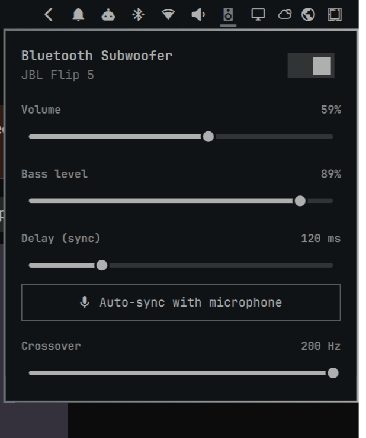

# BT Sub — Bluetooth speaker as a subwoofer for Omarchy

An [Omarchy](https://omarchy.org) shell plugin that turns any Bluetooth speaker into a subwoofer for your main speakers. One click in the bar adds the speaker; the panel sets volume, bass level, delay and crossover.



## Features

- **Crossover:** the Bluetooth speaker gets a mono mix below the crossover (24 dB/oct Linkwitz–Riley low-pass, 50–200 Hz). The main speakers keep full range, with a matching all-pass filter so the two add in phase instead of cancelling around the crossover.
- **Delay sync:** Bluetooth adds ~100–250 ms of latency, so the main speakers are delayed to match. Set it with the slider, or click **Auto-sync with microphone**.
- **Quiet auto-sync:** plays a faint noise probe on each speaker for a few seconds, about 20 dB under typical music. It then finds each arrival with GCC-PHAT correlation. No chirps, and if the mic can't hear the probe it gets slightly louder.
- **Volume handoff:** while the subwoofer is on, your volume keys and the Omarchy audio panel control the combined output. The main speakers run at 100% and go back to your listening volume when you turn it off, even if the chain crashes.
- **Any speaker:** it uses whichever Bluetooth speaker is connected, and re-wires automatically if the speaker reconnects or you switch to another one.
- **Live changes:** delay and crossover apply without interrupting playback.

## Install

```sh
omarchy plugin add https://github.com/thesabbir/omarchy-bt-sub.git --enable
```

Optionally, put the CLI on your `PATH`:

```sh
ln -s ~/.config/omarchy/plugins/sabbir.bt-sub/bin/bt-sub ~/.local/bin/bt-sub
```

### Requirements

- PipeWire with `pipewire-pulse` (`pactl`), `pw-link`, `pw-cli`, `pw-dump`, `pw-cat`
- `jq`, `notify-send`, systemd user session
- For auto-sync: a microphone (a webcam mic works), and `python-numpy` or [`uv`](https://docs.astral.sh/uv/)

## Usage

| Bar icon | Action |
|---|---|
| Left click | Open the panel |
| Right click | Turn the subwoofer on/off |
| Scroll | Bass level (the Bluetooth speaker's volume) |

The icon shows only while a Bluetooth speaker is connected or the sub is on.

Typical setup:
1. Connect the Bluetooth speaker.
2. Turn the sub on.
3. Click **Auto-sync** while some music plays.
4. Set the bass level to taste.

The main speakers are whatever your default output was when you turned the sub on.

### CLI

```
bt-sub on|off|toggle|status
bt-sub delay [SECONDS|+STEP|-STEP]   show or tune main-speaker delay (live)
bt-sub crossover [HZ]                show or set the sub low-pass (live)
bt-sub calibrate                     measure the Bluetooth delay with the mic and apply it
```

Environment overrides: `BT_SUB_MAIN` (main speakers sink), `BT_SUB_TARGET` (Bluetooth sink), `BT_SUB_MIC` (mic source).

Bluetooth latency can drift during the first minutes of a session. To re-sync quietly a few times after turning on (only while something plays), run:

```sh
touch ~/.local/state/bt-sub/autosync
```

Settings and the generated PipeWire config live in `~/.local/state/bt-sub/`.

## How it works

`bt-sub on` starts a transient systemd user unit. The unit runs a standalone PipeWire filter-chain that exposes a **Speakers + BT Sub** sink:

```
            ┌─ delay ─ all-pass ────────────► main speakers (FL/FR)
input L/R ──┤
            └─ mono ─ LR4 low-pass ─────────► Bluetooth speaker (L/R)
```

The chain's 4-channel output is linked directly to both devices with `pw-link`, so there is no extra hidden sink, and a small loop keeps those links in place. The default output switches to the new sink and switches back when you turn it off.

## Notes

- Bluetooth latency varies between sessions, so re-run auto-sync after reconnecting the speaker.
- Calls and games will lag by the delay; turn the sub off for those.
- Lower crossovers (80–120 Hz) tolerate timing errors better. Above ~150 Hz you start to hear where the Bluetooth speaker is.

## License

MIT
